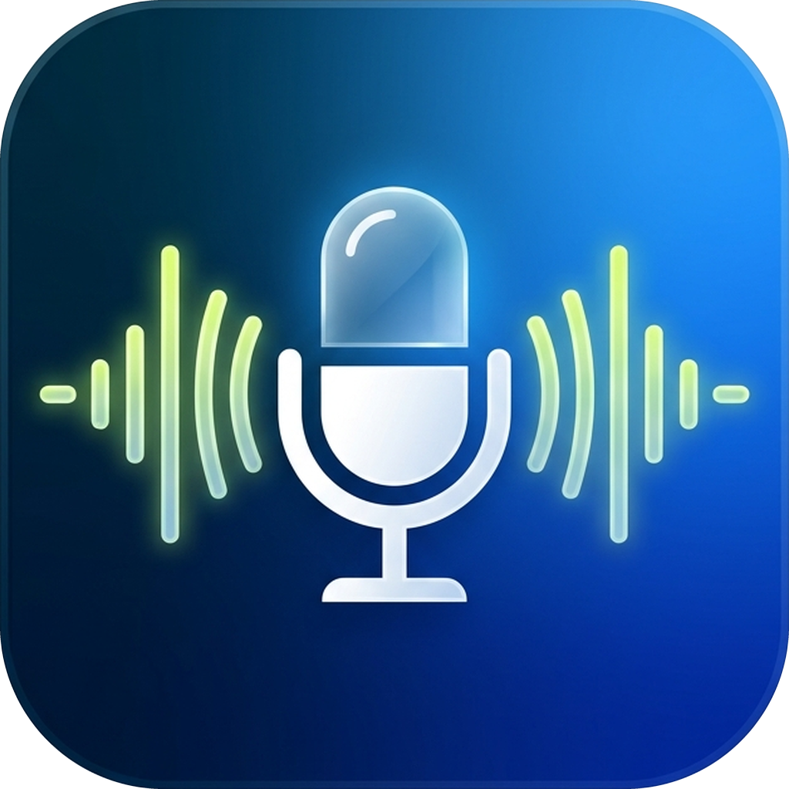

# 🎙️ Samlytics VoiceStudio

<div align="center">
  
  <h3>Free Local Text-to-Voice & Storytelling Desktop Studio</h3>
  <p><b>Democratizing voice synthesis, technical education, and storytelling with a human touch.</b></p>
  <p>100% Free Forever • Zero Subscriptions • Runs Completely on Your Laptop</p>
</div>

---

## 📦 Choose Your Edition

### 🖥️ Edition 1: Desktop Application (For Windows Creators & Educators)
Want to use VoiceStudio as a normal desktop app on your laptop without writing code?

1. **Download the App**:
   - [👉 Click here to Download ZIP](https://github.com/SamsonOluwaseun/free_text_to_voice/archive/refs/heads/main.zip)
2. **Extract the ZIP Folder**:
   - Right-click the downloaded `.zip` file and select **Extract All...**
3. **Run the 1-Click Installer**:
   - Double-click **`install_app.bat`**.
   - It will install dependencies and automatically create a desktop shortcut named **"Samlytics VoiceStudio"** with the official brand icon on your Windows Desktop!

---

### 🤖 Edition 2: AI & MCP Server (For Claude Desktop, Cursor, & Developers)
Want AI tools like **Claude Desktop**, **Cursor**, or **ChatGPT** to generate voice, background music, and `.srt` subtitles directly in your chat?

1. **Download the MCP / AI Package**:
   - [👉 Click here to Download ZIP](https://github.com/SamsonOluwaseun/free_text_to_voice/archive/refs/heads/main.zip)
   - Extract the `.zip` folder to your computer (e.g. `C:\VoiceStudio`).
   - *(For Claude.ai Web)*: You can attach this extracted folder or `.zip` directly into your Claude.ai web chat to run in Claude's code sandbox!

2. **Install Lightweight Dependencies (Zero GUI Bloat)**:
   ```bash
   pip install -r requirements-mcp.txt
   ```

3. **Add to Claude Desktop**:
   Open your `claude_desktop_config.json` and add:
   ```json
   {
     "mcpServers": {
       "voicestudio": {
         "command": "python",
         "args": ["<PATH_TO_EXTRACTED_FOLDER>/mcp_server.py"]
       }
     }
   }
   ```

4. **Chat with Claude**:
   Ask Claude to write any script and voice it. Claude will present interactive options in your chat:
   - Voice selection (e.g. *Nigerian Abeo, Deep Male, Soft Male, Ava*)
   - Background music (e.g. *Lo-Fi, Piano, Strings, Zen Bells*)
   - Speaking speed (e.g. *0.8x, 1.0x, 1.2x*)
   - Subtitle `.srt` export for video editing

5. **Or run Headless CLI directly in terminal**:
   ```bash
   python cli.py speak "Welcome to cloud computing." --voice "Abeo" --music "Lo-Fi" --ducking --srt
   ```

---

## 🗑️ How to Uninstall

If you ever want to uninstall Samlytics VoiceStudio, you can do it in two easy ways:

* **Option A — Through Windows Settings (Standard Windows Way)**:
  1. Open **Windows Settings** > **Apps** > **Installed apps** (or **Control Panel** > **Programs and Features**).
  2. Find **Samlytics VoiceStudio** (Publisher: *Samlytics Data Services*).
  3. Click **Uninstall**.
* **Option B — 1-Click Script**:
  1. Open the app folder and double-click **`uninstall_app.bat`**.
  2. It will automatically remove the Desktop shortcut, Start Menu shortcut, unregister from Windows Programs, and ask if you want to remove the Python packages.

## ✨ Features & Capabilities

### 1. 🎓 Explain Complex Technical Concepts Simply
* Powered by the **Nigerian Professional Male Voice (`Abeo Neural`)**:
  * Crisp, engaging, articulate delivery built specifically for tutorials, tech explainers, and teaching data/software concepts to non-technical audiences.
  * Includes a 1-click **"💡 Tech Tutorial"** template demonstrating how to explain concepts like cloud computing and APIs using everyday real-world analogies.

### 2. 🎙️ Custom Voice Cloning (Live Mic & Audio Upload)
* **Live In-App Microphone Recording**: Click **"🔴 Record from Mic"**, record 5–30 seconds of your voice directly in the app with real-time countdown, and clone immediately!
* **Audio File Upload**: Or upload an existing `.wav` or `.mp3` sample.
* **Instant Acoustic Timbre Morphing**: Analyzes your pitch ($F_0$), formant resonant frequencies, and energy profile to read out any script in your own personal voice.
* **Two-Tier Architecture**:
  * **Tier 1 (Default - Instant)**: Lightweight acoustic timbre matching. Zero huge model downloads; runs in seconds on any standard laptop CPU.
  * **Tier 2 (Optional - Deep Neural)**: Optional in-app upgrade for heavy neural cloning weights with upfront disk/RAM requirement checks.

### 3. 🎬 Precision `.SRT` Subtitle Export
* Export synchronized sentence-by-sentence `.SRT` subtitle files alongside your narration.
* Perfect for video creators importing into **CapCut, Adobe Premiere Pro, DaVinci Resolve, TikTok, or YouTube Closed Captions**.

### 4. 📄 Script & Document Importer
* Load long narration scripts, blog posts, or video scripts directly with the **"📄 Import Script (.txt, .md)"** button with character and word count tracking.

### 5. 📖 Immersive Storytelling & Audiobooks
* Layer your narration over **10 built-in royalty-free ambient instrumentals**:
  1. *Ethereal Piano*
  2. *Lo-Fi Night Thoughts*
  3. *Cinematic Story Strings*
  4. *Cozy Acoustic Warmth*
  5. *Deep Space Ambient*
  6. *Gentle Fairytale Harp*
  7. *Nature & Gentle Rain*
  8. *Meditative Zen Bells*
  9. *Mystery & Suspense*
  10. *Warm Sunrise Hope*
* **Smart Audio Ducking**: The background music automatically softens when you speak, ensuring crystal-clear vocal clarity.
* **Add Your Own Music**: Click **"➕ Import Music"** or drop any MP3/WAV into `background_tracks/`.

### 6. 🎛️ Total Texture, Speed & Gain Control
* **Voice Texture**: Fine-tune depth and resonance from deep/warm ($-20\text{Hz}$) to bright/crisp ($+20\text{Hz}$).
* **Speaking Speed**: Adjust from $0.50\text{x}$ (slow) to $2.00\text{x}$ (fast).
* **Dual Volume Mixers**: Independent sliders for speech ($0–150\%$) and music ($0–100\%$).

### 7. 💾 Studio Audio Player & Multi-Format Export
* Integrated player with real-time seeking scrubber and elapsed/total duration timers.
* Download your finished production with one click as **High-Quality MP3** or **Studio WAV**.

---

## 🎨 Brand Design & Theme

Designed in alignment with the **Samlytics Data Services** brand guidelines:
- **Light & Crisp Interface**: Clean white and warm cream workspace designed for optimal readability.
- **Brand Palette**: Samlytics Vibrant Blue (`#4392F1`), Deep Navy Text (`#00212B`), and Growth Lime Accents (`#DCFF38` / `#C2E812`).
- **Custom Product Identity**: Custom VoiceStudio squircle badge featuring dynamic acoustic soundwaves.

---

## 🤖 Headless CLI & MCP for AI Tools (Claude, ChatGPT, Gemini)

Samlytics VoiceStudio can be used completely headless by AI tools, scripts, and terminal automations:

### 1. Headless CLI
```bash
# Synthesize speech with subtitles
python cli.py speak "Welcome to cloud computing." --voice "Abeo" --out "exports/narration.mp3" --srt

# Full story with background music and ducking
python cli.py speak "In Lagos, engineers are building the future." --music "Lo-Fi" --ducking --out "exports/story.mp3" --srt
```

### 2. Model Context Protocol (MCP) for Claude Desktop
Connect VoiceStudio directly into Claude Desktop by adding this to `claude_desktop_config.json`:
```json
{
  "mcpServers": {
    "voicestudio": {
      "command": "python",
      "args": ["<PATH_TO_VOICESTUDIO>/mcp_server.py"]
    }
  }
}
```

### 3. 🇳🇬 Offline Nigerian Voice Distillation (`en_NG-abeo.onnx`)
Run the turnkey Google Colab notebook `train_offline_abeo.ipynb` on a free T4 GPU to distill the Nigerian Abeo voice into an offline ~45MB Piper ONNX model. Place the resulting files into `offline_models/` for 100% offline speech!

---

## 💻 Launch Desktop GUI App

To launch the desktop interface:
```powershell
python app.py
```

---

## 📄 License
Open source and 100% free for educational, personal, and commercial storytelling use. Powered by **Samlytics Data Services**.
